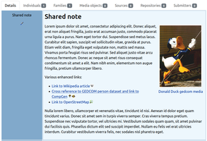
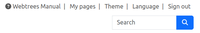
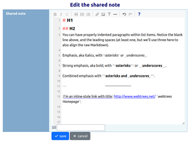
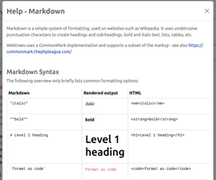

# webtrees module LinkEnhancer

  

> [!IMPORTANT]
> **Primary Repository:** <https://codeberg.org/bschwede/linkenhancer>
>
> **All activity happens on Codeberg:**
>
> - ✅ Issues → [Open on Codeberg](https://codeberg.org/bschwede/linkenhancer/issues)
> - ✅ Pull Requests → [Open on Codeberg](https://codeberg.org/bschwede/linkenhancer/pulls)
> - ✅ Translations → [Contribute on Codeberg Weblate](https://translate.codeberg.org/projects/wt-modules/linkenhancer/)
>
> Mirror Repository: <https://github.com/bschwede/linkenhancer>

## TL;DR
**Cross-references to Gedcom datasets, Markdown editor, context-sensitive link to the GenWiki Webtrees manual**

What you can expect from the module, illustrated with screenshots:

| Screenshots | Screenshots |
| :---: | :---: |
|  |    |
| note with enhanced links and image from media record | site title as home link small menu with help link |
|  |  |
| markdown editor | markdown help |

## Description

This module wraps up some [examples mentioned in the German Webtrees Manual](https://wiki.genealogy.net/Webtrees_Handbuch/Entwicklungsumgebung#Beispiel_-_Querverweise_zu_Datens.C3.A4tzen) and improves the application of these features - each component can be activated individually.

The main purpose of this module is to make [**links to data records**](https://bschwede.codeberg.page/wt-modules/en/docs/linkenhancer/features/enhanced-links/) stored in family trees more convenient. This avoids having to store fully qualified links, which impairs the portability of Gedcom data. By linking the notes to the GEDCOM data records (persons, families, sources, etc.) from the text makes story telling much easier and thus also save this information in the GEDCOM file (maybe this is an alternative for the [stories module](https://wiki.genealogy.net/Webtrees_Handbuch/Anleitung_f%C3%BCr_Besucher#Geschichten)). The option of embedding the [**images**](https://bschwede.codeberg.page/wt-modules/de/docs/linkenhancer/features/markdown/md-image/) already inserted in the family tree in the notes rounds off this approach. The link function is controlled via the [anchor part of the URI](https://developer.mozilla.org/en-US/docs/Learn_web_development/Howto/Web_mechanics/What_is_a_URL), so it's no problem, if this module is not active - the url just points to the current webtrees page.

For the admin there is an [**overview of cross-references**](https://bschwede.codeberg.page/wt-modules/de/docs/linkenhancer/features/enhanced-links/xref-overview/), that lists all GEDCOM records and html based records stored in the `block / block_setting` tables (like html, faq, stories and vesta classic look and feel badges) which contain linkenhancer cross-references, classic cross-references and embedded picture references. The latter two references are only supported in GEDCOM records. For a configurable user access level, an overview can be provided for each tree. On the GEDCOM record detail view you can have an additional tab "cross-references" that lists incoming and outgoing references. The records xref and uids entries (which are sometimes truncated by webtrees core) are also listed to make it easier to reuse them as references in notes.

Additionally there are some goodies more or less related with links:

- [**Renumber XREFs (with links)**](https://bschwede.codeberg.page/wt-modules/en/docs/linkenhancer/features/renumber/) provides an extended renumber that repairs all affected links in one step with solving the XREF collisions.
- There are [**Datafixes**](https://bschwede.codeberg.page/wt-modules/en/docs/linkenhancer/features/datafix/) to address specific link integrity issues.
- [**UID lookup**](https://bschwede.codeberg.page/wt-modules/en/docs/linkenhancer/features/uid-lookup/) — navigate to a record by its persistent UID (`_UID` / `UID` tag), surviving XREF renumbering.
- The note textarea can be a [**visual markdown editor**](https://bschwede.codeberg.page/wt-modules/en/docs/linkenhancer/features/markdown/mde) with **markdown help** (can also be utilized by other custom modules).
- Enabling further [**markdown extensions**](https://bschwede.codeberg.page/wt-modules/en/docs/linkenhancer/features/markdown/md-extensions).
- Take control over [**table cell height**](https://bschwede.codeberg.page/wt-modules/en/docs/linkenhancer/features/markdown/cell-height) of longer markdown notes.
- [**Context sensitive help links**](https://bschwede.codeberg.page/wt-modules/en/docs/linkenhancer/features/wthb/) to the [german webtrees manual](https://wiki.genealogy.net/Webtrees_Handbuch) can be activated in the small menu at the top of the page and for subcontext topics on the page. Furthermore, full-text search is supported and it is possible to browse the table of contents.
- The [**site title can be a link**](https://bschwede.codeberg.page/wt-modules/en/docs/linkenhancer/features/home-link/) to the tree homepage or the user my page.
- A few minor [**patches**](https://bschwede.codeberg.page/wt-modules/en/docs/linkenhancer/features/patches/), that can be applied by bash script (not necessary for this module).

> **Full documentation** (EN/DE): <https://bschwede.codeberg.page/wt-modules/docs/linkenhancer/>

## Requirements

This module requires **webtrees** version 2.2 or 2.3.
It was initially created for version 2.2.4, since linkenhancer 1.6.1 it also works with webtrees 2.3.

> [!TIP]
> It's recommended installing the [Cronjob](https://github.com/bschwede/wt-cronjob) module as well.
> This makes it easy to run the CLI scripts for maintaining the indexes.

## Installation

- Install and use [Custom Module Manager](https://github.com/Jefferson49/CustomModuleManager) for an easy and convenient installation of webtrees custom modules.
- Open the Custom Module Manager view in webtrees, select "linkenhancer", and click on the "Install Module" button.

**Manual installation:**
1. Download the [latest release](https://codeberg.org/bschwede/linkenhancer/releases/latest).
2. Upload the downloaded file to your web server.
3. Unzip the package into your `modules_v4` directory.
4. Rename the folder to `linkenhancer`

## Contributing

See [CONTRIBUTING.md](CONTRIBUTING.md) or the [developer documentation](https://bschwede.codeberg.page/wt-modules/en/docs/linkenhancer/dev/).

## Translation

You can contribute to this project on [Codeberg Weblate](https://translate.codeberg.org/projects/wt-modules/linkenhancer/).

Updated translations will be included in the next release of this module.

## Support

- **Issues**: [Open on Codeberg](https://codeberg.org/bschwede/linkenhancer/issues)
- **Forum**: general webtrees support at the [webtrees forum](http://www.webtrees.net/)

## License

Copyright (C) 2026 Bernd Schwendinger. Derived from **webtrees** - Copyright 2025 webtrees development team.

This program is free software: you can redistribute it and/or modify
it under the terms of the GNU General Public License as published by
the Free Software Foundation, either version 3 of the License, or
(at your option) any later version.

This program is distributed in the hope that it will be useful,
but WITHOUT ANY WARRANTY; without even the implied warranty of
MERCHANTABILITY or FITNESS FOR A PARTICULAR PURPOSE. See the
GNU General Public License for more details.

You should have received a copy of the GNU General Public License
along with this program. If not, see <http://www.gnu.org/licenses/>.
